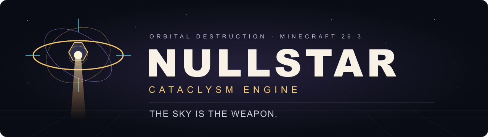
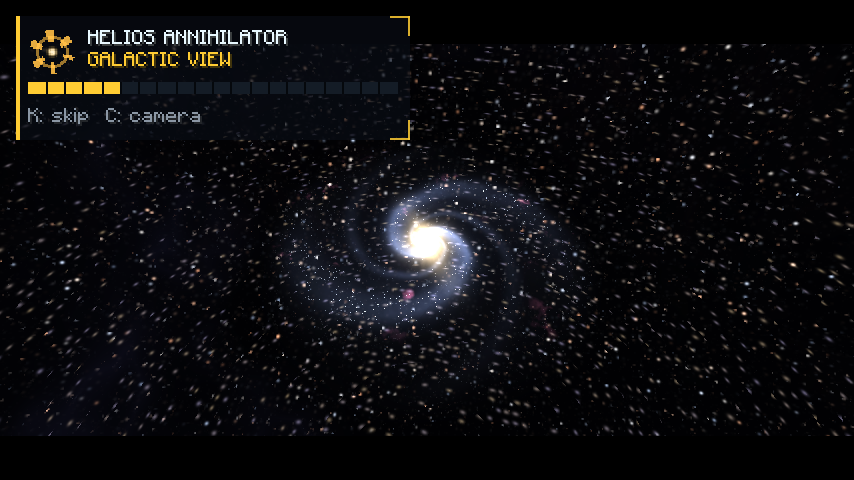
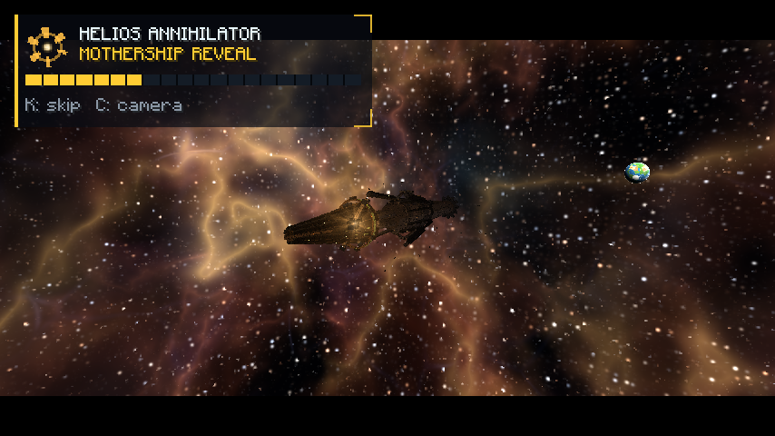
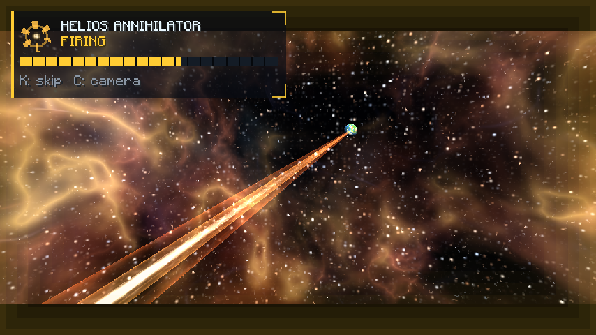
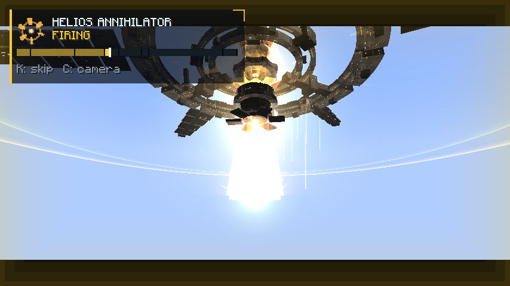
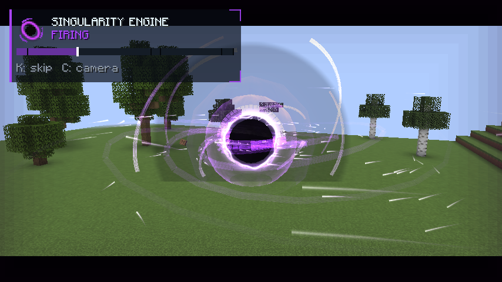
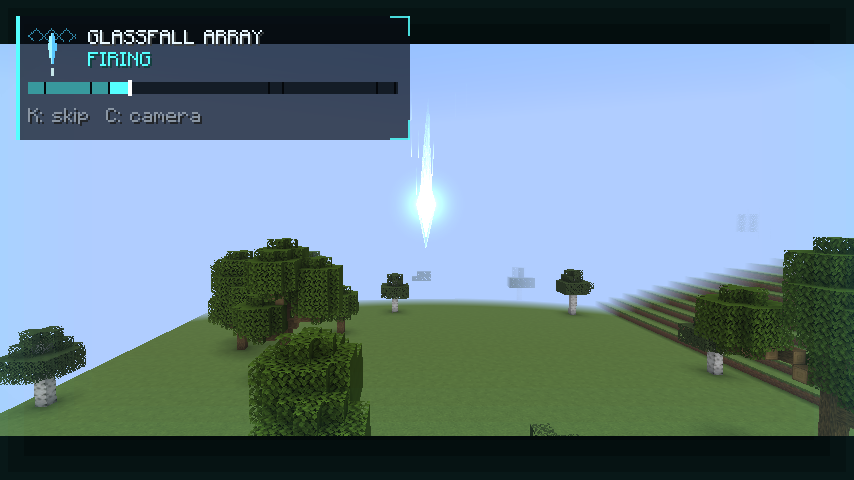

<div align="center">



### The sky is the weapon.

**Three orbital weapons. A cosmic journey. A world that remembers the impact.**

[](#requirements)
[](#installation)
[](#building-from-source)
[](LICENSE)
[](https://github.com/ToontownSuperForeverMVP/NULLSTAR/actions/workflows/build.yml)

[Get started](#installation) · [Weapons](#the-arsenal) · [Colossal strikes](#colossal-strikes) · [Configuration](#server-configuration) · [Build & test](#building-from-source)

</div>

NULLSTAR: **Cataclysm Engine** is an original Minecraft **26.3** Fabric mod that turns orbital destruction into a directed spectacle. Deploy a golden stellar collector, form a gravitational anomaly, or unfold a crystalline bombardment array. Watch machinery assemble, energy gather, and the sky answer your designation—then walk through the crater it leaves behind.

The spectacle has teeth. Targeting, authorization, cooldowns, damage, attraction, impact scheduling, and terrain excavation belong to the server. The client builds the machinery, cinematic camera, shaders, particles, soundscape, and holographic interface from that authoritative timeline. Cosmetic scale and physical destruction are independently controlled, so operators can preview enormous scenes without excavating the world.

This repository includes the current **Part 3** source, original assets, reproducible asset generators, tests, operator examples, and dated engineering evidence. Implementation, automated observations, and human artistic/audio approval are distinguished in [Verification and limitations](#verification-and-limitations).

## What NULLSTAR brings to Minecraft

- **Three distinct weapon systems:** Helios Annihilator, Singularity Engine, and Glassfall Array, each with its own machinery, colors, camera direction, sound design, and terrain signature.
- **Persistent terrain deformation:** irregular basins, deep collapse regions, overlapping bombardment craters, and scorched material transformations saved by Minecraft.
- **STANDARD, TITANIC, and APOCALYPSE scales:** six configurable colossal profiles, public-server clipping, and explicit confirmation for destructive colossal activation.
- **A world-to-cosmos Helios sequence:** atmospheric ascent, planet, solar system, galaxy, cosmic boundary, star-harvesting mothership, stellar discharge, and a return to ground-level devastation.
- **Authored presentation:** procedural machinery, original GLSL materials, layered energy beams, pressure fronts, smoke, fragments, and extended aftermaths.
- **Directed cinematography:** tracking, roll, rumble, impact shake, FOV changes, and view restoration. Your player remains in the world and can still move.
- **Original synthesized audio:** phase cues, long-form cosmic beds, mechanical locks, projectile launches, atmospheric descent, release, and distance-delayed aftershocks.
- **An Orbital Controller and holographic HUD:** weapon selection, target lock, designation countdown, phase timeline, excavation progress, cooldowns, and completion/cancellation feedback.
- **Presentation and accessibility controls:** LOW/MEDIUM/ULTRA quality, particle budgets, glow, distortion, camera shake, audio, letterbox, reduced motion, and reduced flashing.
- **Optional Mod Menu integration:** the same local settings screen from Minecraft's Mods menu, with immediate changes and Reset defaults.
- **Bounded server work:** global candidate budgets, reserved impact jobs, protection checks, loaded-only access, deferred-region replay, diagnostics, and optional graceful-restart recovery.

## The arsenal

### HELIOS ANNIHILATOR

**A star, pointed at a coordinate.**

Helios deploys an asymmetric golden orbital collector. Solar vanes unfold, focusing rings counter-rotate, targeting pods align, and reactor petals open around a contained plasma core. The aperture releases a layered white-hot stellar beam through the atmosphere. Impact becomes an incandescent pillar, expanding shock fronts, pressure waves, debris, and a scorched basin.

At colossal scale, the strike opens into a cosmic journey. An authored ascent moves through planetary, solar-system, galactic, and observable-universe compositions before revealing a star-harvesting mothership. Its collars, harvest vanes, pylons, and iris deploy around a contained star. The stellar lance returns to the designated world, followed by regional devastation and a long crater aftermath.

Helios leaves a rounded, irregular basin. Supported exposed shell materials transform into basalt, blackstone, or coal.

### SINGULARITY ENGINE

**The ground learns which way gravity really points.**

A dark event horizon forms inside violet accretion structures. Tilted rings, shearing disk bands, photon arcs, and spiraling matter build into a gravitational anomaly. Eligible living entities are attracted during firing under the server's interaction rules. The core compresses, the soundscape holds its breath, and the implosion releases a violent pressure event.

Colossal Singularity enlarges the anomaly and rings, prolongs attraction and compression, and presents a deep gravitational sink with fracture fronts, release jets, and settling dust. Its physical signature is a deeper ellipsoidal excavation with obsidian and blackstone shell transformations.

The lensing is an authored geometric/shader illusion, not a physical black-hole simulation or general screen-space ray tracing. Visual slabs and shards are cosmetic; living-entity forces are authoritative.

### GLASSFALL ARRAY

**Precision bombardment, written in crystal.**

An orbital lattice unfolds into counter-rotating frames, extending trusses, glowing conduits, focusing lenses, and aimed launch rails. Crystalline projectiles follow deterministic flight curves that meet the server's scheduled impact sites. Four STANDARD peripheral strikes precede a larger central impact, each adding sharp shock rings, shards, dust, and a crater.

Colossal Glassfall becomes a monumental bombardment platform with ring stacks, docking cradles, capacitor banks, and aiming booms. TITANIC fires eight peripheral projectiles; APOCALYPSE fires sixteen. Both finish with a central strike and two regional excavation rings. The finale adds a crystal-energy dome, pressure effects, and a sustained cyan aftermath.

Projectiles are synchronized presentation rather than independent physics entities. Sand at supported scorch boundaries becomes glass; stone becomes basalt.

### STANDARD reference values

Bundled defaults at multiplier 1 and nominal **20 TPS**. Range, radius, and depth are in blocks; operator overrides and caps can change effective geometry.

| Weapon | Target range | Main radius / depth | Timeline | Cooldown from authorization |
| --- | ---: | ---: | ---: | ---: |
| Helios Annihilator | 128 | 20 / 13 | 300 ticks · 15 s | 600 ticks · 30 s |
| Singularity Engine | 112 | 13 / 18 | 355 ticks · 17.75 s | 500 ticks · 25 s |
| Glassfall Array | 128 | 16 / 10 | 395 ticks · 19.75 s | 700 ticks · 35 s |

The cinematic may finish before terrain work does. Cooldown starts at authorization and is not reset by cancellation. A strike can remain registered while its excavation jobs finish. See [Weapon specifications](docs/WEAPON_SPECIFICATIONS.md) for historical STANDARD phase/cue detail; current colossal defaults are below.

## Colossal strikes

STANDARD uses normal weapon definitions. TITANIC and APOCALYPSE use independent validated profiles in `config/nullstar/scales.json`.

| Weapon | TITANIC radius / depth | TITANIC timeline | APOCALYPSE radius / depth | APOCALYPSE timeline |
| --- | ---: | ---: | ---: | ---: |
| Helios | 128 / 48 | 70 s | **500 / 96** | **180 s** |
| Singularity | 96 / 64 | 60 s | 320 / 160 | 90 s |
| Glassfall | 112 / 40 | 70 s | 360 / 80 | 100 s |

These are **profile dimensions**, not a promise that default policy permits that footprint. Public mode clips physical geometry; destructive Apocalypse is disabled by default. Scene, structure, beam, shockwave, blast, and entity-field parameters are separately validated. An enormous visual beam does not automatically grant enormous damage.

Apocalypse Helios specifies a nominal **1,000-block-diameter main basin**, with secondary annular passes extending to radii 575 and 650. Seeded boundary irregularity and protection affect the final outline. Glassfall APOCALYPSE reserves **19 impact jobs** before admission: sixteen peripheral impacts, one center, and two rings. The default 16-job limit must be raised to admit it.

Start with an inert preview while aiming at a loaded surface within normal weapon range:

```mcfunction
/nullstar preview helios apocalypse
```

For destructive private-world use, review the [private Apocalypse configuration](docs/config-examples/private-apocalypse.server.json), apply it to the server configuration, and reload while no strikes/jobs are active. Inspect the policy-clipped footprint before authorizing it:

```mcfunction
/nullstar bounds helios apocalypse
/nullstar fire helios apocalypse
/nullstar confirm
```

Default confirmation is target-bound, single-use, and expires after ten seconds. **Skipping the cinematic does not cancel damage. Cancelling does not restore blocks already changed.**

Large excavation is incremental. A short cinematic can schedule many minutes of candidate processing. No chunks are force-loaded: deferred regions are revisited when normal play loads them, within the waiting window. Protection, unloaded terrain, cancellation, and change limits can leave a footprint incomplete.

## Requirements

| Component | Project target |
| --- | --- |
| Minecraft | **26.3 only** |
| Java | **25** JDK for development; Java 25+ required by metadata |
| Fabric Loader | **0.19.5** pinned for development |
| Fabric API | **0.162.0+26.3** pinned; required at runtime |
| Mod Menu | **21.0.0**, optional and client-only |
| Fabric Loom | **1.18.3**, pinned build plugin |
| Gradle | **9.7.1**, supplied wrapper with distribution checksum |

Install NULLSTAR and Fabric API on **both client and server**. Dedicated servers run the authoritative engine without client rendering classes. The project uses unobfuscated Minecraft names and the 26.3 rendering/input APIs. Kotlin is not required. Other Minecraft versions and mod loaders are not supported by this source tree.

## Installation

1. Create a **Minecraft 26.3 Fabric** instance using Java 25 and the dependencies above.
2. Build from source below, or obtain a production JAR from a successful [GitHub Actions build](https://github.com/ToontownSuperForeverMVP/NULLSTAR/actions). Workflow artifacts are build outputs, not a separate stable-release guarantee.
3. Put **`nullstar-1.0.0.jar`** and matching Fabric API in the instance's `mods` directory. Install the same mod on your multiplayer server.
4. Optionally add Mod Menu 21.0.0 to the client.
5. Launch. Configuration is created under `config/nullstar` on first initialization.

Install the production JAR only. The `-sources.jar` is for developers; **`nullstar-test` must never be installed as the production mod**. Dedicated servers do not need Mod Menu. Use a disposable creative world for a first destructive strike: terrain changes are saved, and cancellation is not rollback.

## Your first strike

With cheats/operator permission enabled:

```mcfunction
/nullstar give
```

The **Orbital Controller** is also in creative **Tools & Utilities**. Hold it in either hand, choose a weapon, and aim at a loaded solid surface. Use once to designate; use again to authorize. Designations expire after ten seconds. Defaults allow one active strike per owner and four simultaneous strikes.

| Default input | Action |
| --- | --- |
| Sneak + Use, or **V** | Cycle the selected weapon |
| Use, or **G** | Designate; activate an existing designation |
| **K** | Skip your cinematic while the strike continues |
| **C** | Toggle cinematic camera effects |
| **N** | Open presentation settings |

Rebind keys in Minecraft's Controls menu. Mod Menu exposes the same settings through **Mods → NULLSTAR → Configure**.

The holographic HUD shows weapon selection, lock/range state, designation countdown, phase timeline, terrain progress, cooldown, and completion/abort feedback. A ground marker previews the selected weapon's targeting footprint. Use `/nullstar bounds` for authoritative policy-clipped colossal envelopes and individual impacts.

Directed shots move the view, not the player. Observers keep their camera and see world effects. Reduced motion keeps your gameplay view; **K** returns you to it during a strike.

## Commands

`<weapon>`: `helios`, `singularity`, or `glassfall`. `<tier>`: `standard`, `titanic`, or `apocalypse`. Brackets denote optional arguments; do not type them.

| Command | Purpose |
| --- | --- |
| `/nullstar give` | Give yourself a controller |
| `/nullstar target` | Acquire the loaded surface under your aim |
| `/nullstar fire <weapon> [x y z]` | Fire at your selected/default scale |
| `/nullstar fire <weapon> <tier> [x y z]` | Request a specific activation scale |
| `/nullstar preview <weapon> [x y z]` | Inert preview at selected/default scale |
| `/nullstar preview <weapon> <tier> [x y z]` | Inert preview at a specific scale |
| `/nullstar scale <tier>` | Select subsequent activation scale |
| `/nullstar bounds <weapon> <tier> [x y z]` | Print inert bounds, waves, and candidate counts |
| `/nullstar confirm` | Confirm a pending destructive colossal request |
| `/nullstar status` | Inspect events, jobs, progress, changes, and work time |
| `/nullstar diagnostics` | Print/log bounded terrain-job diagnostics |
| `/nullstar cancel` | Cancel your owned strikes/jobs |
| `/nullstar abort <strike-uuid>` | Operator abort of a specific event/job group |
| `/nullstar emergency_abort` | Operator abort of all events/jobs |
| `/nullstar reload` | Reload validated server data while idle |

Give, fire, scale, bounds, confirm, diagnostics, abort, emergency abort, and reload require game-master/operator permission. Preview obeys `operatorsOnly`, enabled by default. It uses a slot/cooldown and emits visual/audio cues but creates no damage, attraction, or block changes.

Server-command coordinates still undergo range, loaded-ground, border, and protection checks. Most commands need a player context. Reload is rejected while events or recovered work remain; invalid replacement data retains prior configuration.

## Server configuration

| File | Responsibility |
| --- | --- |
| `config/nullstar/server.json` | Authorization, budgets/caps, colossal policy, recovery, timing/audio multipliers |
| `config/nullstar/scales.json` | Six validated TITANIC/APOCALYPSE profiles |
| `config/nullstar/weapons/helios.json` | Optional Helios override |
| `config/nullstar/weapons/singularity.json` | Optional Singularity override |
| `config/nullstar/weapons/glassfall.json` | Optional Glassfall override |
| `config/nullstar/client.json` | Local presentation preferences |

Use the [bundled JSON](src/main/resources/data/nullstar/weapons) as the weapon schema/reference. Definitions are validated operator data loaded from classpath/config, not data-pack reloadable. Unknown override filenames and sound IDs produce diagnostics.

### Defaults and limits

| Server option | Default | Meaning |
| --- | ---: | --- |
| `terrainDestruction` | `true` | Physical work; false makes strikes physically inert |
| `operatorsOnly` | `true` | Operator activation, including previews |
| `maximumRadius` / `maximumDepth` | `24` / `24` | STANDARD caps, each clamped to 1–48 |
| `blockOperationsPerTick` | `1536` | Global candidates/tick, clamped to 16–8192 |
| `maximumActiveStrikes` | `4` | Active events, clamped to 1–8 |
| `maximumJobs` | `16` | Outstanding/reserved impacts, clamped to 1–32 |
| `entityBudget` | `64` | Living entities processed per interaction, clamped to 1–128 |
| `defaultScale` | `STANDARD` | Default scale |
| `apocalypseEnabled` | `false` | Destructive Apocalypse opt-in |
| `publicServerMode` | `true` | Public clipping for colossal geometry |
| `publicMaximumRadius` | `48` | Public colossal radius cap |
| `colossalCinematicOnly` | `false` | Makes larger profiles physically inert when enabled |
| `requireColossalConfirmation` | `true` | Confirmation for destructive colossal activation |
| `maximumColossalDiameter` / `maximumColossalDepth` | `1536` / `192` | Private caps; absolute limits 2048 / 384 |
| `maximumSimultaneousColossalJobs` | `2` | Concurrent composite colossal work |
| `maximumDevastationWaves` | `8` | Scheduled-wave bound |
| `maximumChangedBlocks` | `100000000` | Change limit; validated maximum one billion |
| `maximumEntityRadius` | `128` | Colossal entity-field cap; absolute maximum 512 |
| `colossalObserverRange` | `2048` | Colossal state range; clamped to 256–4096 |
| `deferUnloadedRegions` | `true` | Remember unloaded tiles for later loaded-only excavation |
| `deferredRegionTicks` | `6000` | Post-main-pass waiting window: five minutes at 20 TPS; maximum 72000 ticks |
| `persistDestructionJobs` | `false` | Save committed terrain cursors for graceful recovery |

Timing, cooldown, and volume multipliers default to 1. Values are validated/clamped; settings cannot remove hard bounds. Duration scaling occurs once at definition load, with scaled stages capped at 2400 ticks and cues mapped proportionally into those stages.

Start with the [public-server example](docs/config-examples/public-server.server.json) or [private Apocalypse example](docs/config-examples/private-apocalypse.server.json). The private example enables Apocalypse, disables public clipping, raises reservations to 32, uses the maximum 8192-candidate budget, and enables persistence. It explicitly opts into large physical destruction.

### Terrain, protection, and recovery

Every candidate consumes the **same global tick budget**, including air, skipped/protected blocks, and unloaded cells. Deferred replay and tile probes also consume budget. Round-robin slices and a cooperative time deadline bound work; the deadline is not a hard real-time guarantee.

The engine never force-loads chunks or keeps chunk references. It skips containers/block entities, unbreakable blocks, the [protected-block tag](src/main/resources/data/nullstar/tags/block/protected_blocks.json), world/build limits, and blocks vetoed by vanilla protection or `ProtectionHooks`. Specific third-party claim bridges are not bundled. Player interactions respect PvP/team permissions; attributed blast damage belongs to the activating owner.

Unloaded tiles are remembered in a bounded bitset when deferral is enabled. After the main pass, jobs revisit tiles loaded by normal play until the waiting window expires. **100% main-pass progress does not prove every deferred tile was excavated.** Lifecycle cancellation, protection, and the changed-block limit still apply.

With persistence enabled, committed cursors are saved in the world's `data/nullstar-jobs-v1.json`. Graceful recovery waits for the authorized owner to return. Future cinematic cues and cooldowns do not resume. This is not a power-loss transaction journal coordinated with chunk saves.

## Presentation and accessibility

Client settings never change damage, authorization, or terrain caps. Changes apply immediately and save on **Done** or **Escape**.

| Client option | Default | Effect |
| --- | --- | --- |
| Quality | MEDIUM | LOW/MEDIUM/ULTRA detail and cosmetic caps |
| Particle intensity | 100% | Cosmetic particles/debris; zero disables them |
| Native particle budget | 192/tick | LOW/fallback particle budget, adjustable 0–512 |
| Cinematic camera | Enabled | Directed shots |
| Camera shake | 0.35 | Rumble/impact intensity |
| Reduced motion | Disabled | Keeps your view and suppresses shake |
| Reduced flashing | **Enabled** | Caps/replaces bright flashes |
| Screen distortion | Enabled | Optional distortion/lensing-style layers |
| Glow | 100% | Energy glow intensity |
| Cinematic audio | 100% | Local cinematic accent level |
| Letterbox | Enabled | Framing bars |

MEDIUM/ULTRA use custom materials and bounded per-layer geometry. Blended pipelines include 26.3 Improved Transparency/OIT support. Pipelines are optional: shader failure latches into fallback presentation instead of repeatedly crashing. LOW uses native fallback presentation.

The cosmic act is a view-local sequence rather than remote astronomical world geometry. During detached stages the real camera parks above the player while the scene is composed around the view; the player is never teleported. World shots return to local framing. View state is restored on skip, stale state, cancellation, level changes, disconnect, and death.

## Gallery

**Current Part 3 cosmic presentation**, captured during publication validation at ULTRA quality. These graphical fixtures reconstruct timeline states over a generated world; the screenshots show presentation, not proof of terrain excavation. Click an image to inspect the full frame.

| Galactic view | Star-harvesting mothership | Stellar lance |
| --- | --- | --- |
|  |  |  |

These **historical automated in-game captures from Part 2** show the three weapon identities. They are not screenshots of the rebuilt Part 3 cosmic act. Additional dated captures/logs live in [docs/evidence](docs/evidence).

| Helios · stellar discharge | Singularity · accretion | Glassfall · crystalline descent |
| --- | --- | --- |
|  |  |  |

## Building from source

Install a **Java 25 JDK**, point `JAVA_HOME` to it, and use the wrapper. No global Gradle installation is needed.

```sh
git clone https://github.com/ToontownSuperForeverMVP/NULLSTAR.git
cd NULLSTAR
./gradlew clean build
```

Windows PowerShell:

```powershell
git clone https://github.com/ToontownSuperForeverMVP/NULLSTAR.git
Set-Location NULLSTAR
# JAVA_HOME must point to your Java 25 JDK.
.\gradlew.bat clean build
```

Production: **`build/libs/nullstar-1.0.0.jar`**. Sources: `build/libs/nullstar-1.0.0-sources.jar`. Build includes JUnit and dedicated server GameTests; the development test mod is excluded from the production JAR.

```sh
./gradlew runClient
./gradlew runServer
```

Development launchers use `run`; tests use disposable worlds under `build/run`. Keep tests away from existing saves. Test configuration accepts the Minecraft EULA for automated servers; normal `runServer` uses `run/eula.txt`.

Generate unobfuscated Minecraft sources in a **separate invocation**:

```sh
./gradlew genSources
./gradlew build
```

Do not combine source generation and compile/build: Loom rewrites the generated JAR and triggers Gradle dependency validation. Do not add Yarn mappings or GLFW calls to this 26.3 project.

### Automated client suites

```sh
./gradlew runClientGameTest
./gradlew runClientGameTest -Ptests=regression,dedicated,capture,colossal
./gradlew runClientGameTest -Ptests=settings -PwithoutModMenu
./gradlew runClientGameTest -Ptests=capture -Pcapture=part3helios,part3singularity,part3glassfall,part3oit
```

On PowerShell use `gradlew.bat` and quote comma-separated properties, such as `"-Ptests=regression,dedicated,capture,colossal"`.

| Suite | Coverage |
| --- | --- |
| `settings` | Mod Menu, preferences, navigation, persistence, standalone settings |
| `regression` | Weapons, preview, cancellation, camera restoration, dimension changes, crater persistence |
| `dedicated` | Dedicated-server connection, network activation, disconnect cancellation, reconnect |
| `capture` | Presentation beats, quality/accessibility, transparency, concurrent visual stress |
| `colossal` | Colossal scenes/state, late snapshots, skip, terrain, unfinished-job recovery |
| `destruction` | Real-terrain measurements and deferred replay |

Historical capture selections: `helios,singularity,glassfall,colossal,modes,stress`. `part3*` selections exercise rebuilt presentation over generated terrain; presentation fixtures can reconstruct late state without authorizing damage. Captures appear under the client test run's `build/evidence`. Read fixture source and dated evidence before treating a capture as destructive-gameplay proof.

PowerShell 7 artifact validation:

```powershell
pwsh -File scripts/verify-artifact.ps1 -Output build/artifact-validation.json
```

### Reproducible original assets

[tools/assets](tools/assets) generates textures and synthesized audio from fixed-seed oscillators, filtered noise, and synthetic reverb. No third-party recordings/samples are used.

```sh
python -m pip install numpy Pillow soundfile
python -I tools/assets/generate_textures.py
python -I tools/assets/generate_audio.py
python -I tools/assets/validate_audio.py
```

Generators overwrite checked-in outputs; review diffs when intentionally regenerating. Python tools are optional for development, not mod runtime dependencies.

## Verification and limitations

Implemented behavior, automated observations, and human artistic/audio approval are separate. A green build verifies exercised paths; it does not establish compatibility with every modpack or complete every maximum footprint.

[Part 3 destruction measurements](docs/evidence/part3/destruction-measurements.json) record actual generated-world work:

- Radius 64 / depth 24: **224,613 block changes**, with the full main candidate pass observed loaded.
- Radius 160 / depth 48: **2,223,268 changes**, with about 73% of recorded main-pass chunk visits loaded.
- Apocalypse Helios radius 500 / depth 96: **7,014,686 changes** after measured main processing, rising to **8,539,690** after deferred replay. Replay excavated 857 deferred tiles; **13,678 remained deferred** in that snapshot.

Measurements use accelerated engine ticks. Accelerated wall-clock times are **not normal gameplay completion times or general performance benchmarks**. At 1536 candidates/tick, the recorded large pass represents about 158 minutes of engine ticks at 20 TPS, before remaining replay. Terrain, loaded area, protection, budgets, and hardware affect results.

Open acceptance includes full maximal-footprint excavation, worst-case dense-world performance, multiple independent graphical clients, third-party render/shader/claim compatibility, and human artistic/audio sign-off. True optical simulation, physical debris, and astronomical travel are outside the presentation model.

See [Acceptance](docs/ACCEPTANCE.md), [Validation](docs/VALIDATION.md), [Part 2 report](docs/PART2_RELEASE_REPORT.md), [Part 2.5 report](docs/PART25_RELEASE_REPORT.md), and [publication evidence](docs/REPOSITORY_PUBLICATION.md). Historical reports describe earlier revisions; current source and latest evidence take precedence for current defaults.

## Source map and contributing

| Path | Contents |
| --- | --- |
| `src/main/java/com/nullstar` | Common registration, authoritative engine, configuration, items, networking, timelines, terrain, protection |
| `src/client/java/com/nullstar/client` | Client state, HUD/settings, camera, rendering, audio, optional integrations |
| `src/main/resources` | Metadata, original assets, item resources, tags, weapon definitions |
| `src/client/resources` | Client Mixin and original shaders |
| `src/test/java` | JUnit regressions |
| `src/gametest` | Development-only server/client integration tests |
| `tools/assets` | Asset generators/audio validator |
| `scripts` | Artifact verification |
| `docs` | Architecture, operator examples, handoffs, acceptance, dated evidence |

Read [AGENTS.md](AGENTS.md), [Project state](docs/PROJECT_STATE.md), [Architecture](docs/ARCHITECTURE.md), and [engineering handoff](docs/HANDOFF_TO_OPUS.md) before changing systems. Preserve server authority, global candidate accounting, protection, versioned payloads, and the common/client split. Add camera scripts/sounds through existing registries rather than weapon branches in the Mixin.

Gameplay changes require build/JUnit/dedicated tests; presentation, input, and network changes also require client GameTests. Keep test classes out of production. Include exact validation and untested boundaries in pull requests. [Report issues](https://github.com/ToontownSuperForeverMVP/NULLSTAR/issues) with versions/commit, configuration, reproduction, and relevant logs; remove private information before attaching logs.

## License and credits

Copyright © 2026 **ToontownSuperForeverMVP and NULLSTAR contributors**.

Original NULLSTAR code, generated assets, and project documentation are licensed under **GNU GPL version 3 only** (`GPL-3.0-only`). See [LICENSE](LICENSE) for full terms and [NOTICE](NOTICE) for scope/provenance. Modified covered distributions must meet GPLv3's source and licensing requirements.

Gradle wrapper components and pre-existing template material retain their own notices. Minecraft, Fabric, Mod Menu, Python dependencies, and GitHub Actions are external projects and are not relicensed here. The former template CC0 text is preserved in [licenses/CC0-1.0.txt](licenses/CC0-1.0.txt).

NULLSTAR is independent and is not an official Minecraft product or approved by Mojang or Microsoft.

<div align="center">

**NULLSTAR · CATACLYSM ENGINE**<br>
*The sky is the weapon.*

</div>
